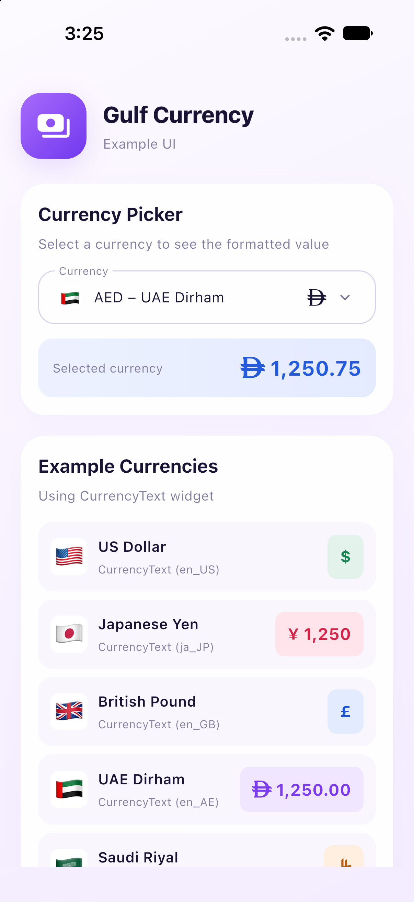

# gulf_currency

A Flutter currency text package for real apps.

It formats int, double, num, and numeric String values as currency widgets, with built-in symbol-font support for:

- AED (UAE Dirham)
- SAR (Saudi Riyal)
- OMR (Omani Rial)
- MVR (Maldivian Rufiyaa)

All other currencies are also supported through locale-driven ISO currency resolution.

## Articles

- [Solving the AED, SAR, and OMR Symbol Problem in Flutter](https://medium.com/p/f668b017596a)

## Unicode status (important)

- AED symbol: officially accepted for Unicode 18.0, but not reliably available in mainstream device fonts yet.
- OMR symbol: scheduled for Unicode 18.0, but not reliably available in mainstream device fonts yet.
- MVR symbol: scheduled for Unicode 18.0, but not reliably available in mainstream device fonts yet.
- SAR symbol: no permanent Unicode codepoint yet.

Because of this, this package bundles the required fonts so AED, SAR, OMR, and MVR symbols can render correctly in Flutter UI today.

## Font files used

This package supports all world currencies through locale-based formatting.
The bundled font files below are specifically for official symbol rendering of AED, SAR, OMR, and MVR:

- AED (Dirham): lib/fonts/dirham/dirham.ttf
- SAR (Saudi Riyal): lib/fonts/saudi_riyal/saudi-riyal-symbol.ttf
- OMR (Omani Rial): lib/fonts/omani_rial/omani-rial-symbol.ttf
- MVR (Maldivian Rufiyaa): lib/fonts/mvr_rufiyaa/mvr-rufiyaa-symbol.ttf

## Search keywords 

This package is useful if you are searching for:

- UAE Dirham symbol Flutter
- AED symbol not showing
- Saudi Riyal symbol Flutter
- SAR currency symbol font
- Omani Rial symbol Flutter
- OMR symbol Unicode support
- Maldivian Rufiyaa symbol Flutter
- MVR currency symbol font
- Gulf currency symbol package Flutter
- Arabic currency symbol Flutter

## Why this package

- CurrencyText auto-resolves currency from locale.
- AED, SAR, OMR, and MVR symbols render with bundled fonts out of the box.
- Great for UI currency display with locale-aware formatting.

## Install

Add this to pubspec.yaml:

```yaml
dependencies:
  gulf_currency: ^2.0.1
```

Enable the Material Icons font in your app's `pubspec.yaml` for the picker's
dropdown arrow and selection checkmark:

```yaml
flutter:
  uses-material-design: true
```

Then import:

```dart
import 'package:gulf_currency/gulf_currency.dart';
```

## Quick start

### Widget usage (recommended)

```dart
CurrencyText(1250.75, locale: 'en_AE');
CurrencyText(1250.75, locale: 'ar_SA');
CurrencyText(1250.75, locale: 'en_OM');
CurrencyText(1250.75, locale: 'en_MV');
CurrencyText(1250.75, locale: 'en_US');
CurrencyText(1250.75, currencyCode: 'QAR', locale: 'en_US');
```

Supply `currencyCode` to choose the currency explicitly, including a value
returned by `CurrencyPicker`. The locale still controls number formatting.

Pass null, an empty string, or a whitespace-only string to display just the
currency symbol:

```dart
CurrencyText('', currencyCode: 'AED');
CurrencyText('', currencyCode: 'USD');
CurrencyText(null, currencyCode: 'SAR');
```

The symbol keeps its configured style and bundled font, with no amount or
extra symbol spacing. A numeric zero still displays a formatted zero amount.

### CurrencyPicker

A controlled dropdown for selecting a currency. Each row shows its country
flag, currency name, and symbol. The picker includes the
currencies in `allCurrencyOptions` by default. Keep the selected code in your
widget state and update it in `onChanged`:

```dart
class CurrencyPickerExample extends StatefulWidget {
  const CurrencyPickerExample({super.key});

  @override
  State<CurrencyPickerExample> createState() => _CurrencyPickerExampleState();
}

class _CurrencyPickerExampleState extends State<CurrencyPickerExample> {
  String selectedCurrencyCode = 'AED';

  @override
  Widget build(BuildContext context) {
    return Column(
      children: [
        CurrencyPicker(
          value: selectedCurrencyCode,
          onChanged: (code) {
            setState(() => selectedCurrencyCode = code);
          },
        ),
        const SizedBox(height: 16),
        CurrencyText(
          1250.75,
          currencyCode: selectedCurrencyCode,
          locale: 'en_US',
        ),
      ],
    );
  }
}
```

The default row uses the bundled fonts for AED, SAR, OMR, and MVR symbols.
Other currencies use the symbols or abbreviations in the circulating-currency
catalog. The same catalog is used by `CurrencyText`. To limit the choices or
customize the field and rows, use these options:

- `options`: list of `CurrencyOption`s; defaults to `allCurrencyOptions`.
- `label`: field label, defaulting to `'Currency'`.
- `decoration`: custom `InputDecoration`; when supplied, it replaces the default decoration and label.
- `style`: text style for the currency name and symbol; bundled symbols keep their required font family.
- `dropdownColor`: background color of the open menu.
- `borderRadius`: corner radius of the field and menu, defaulting to 12.
- `showFlag`: set to `false` to hide the country flag.
- `itemBuilder`: custom row builder, used for both the selected value and menu options.
- `selectedItemBuilder`: separate builder for the closed field; overrides `itemBuilder` there.
- `dropdownIcon`: custom arrow widget, including its size and color.
- `dropdownConstraints` and `dropdownOffset`: popup size and position adjustment.
- `dropdownElevation` and `dropdownShape`: popup shadow and shape, including its border.
- `itemPadding` and `itemHeight`: padding and minimum height for each menu row.
- `selectedItemColor` and `showSelectedCheckmark`: selected row highlight and checkmark visibility.

For example, customize the popup and keep the default flag, name, and symbol rows:

```dart
CurrencyPicker(
  value: selectedCurrencyCode,
  onChanged: (code) => setState(() => selectedCurrencyCode = code),
  options: const <CurrencyOption>[
    CurrencyOption(currencyCode: 'AED', countryCode: 'AE'),
    CurrencyOption(currencyCode: 'USD', countryCode: 'US'),
  ],
  decoration: const InputDecoration(
    labelText: 'Choose currency',
    border: OutlineInputBorder(),
  ),
  style: const TextStyle(fontSize: 14),
  dropdownColor: Colors.white,
  dropdownIcon: const Icon(Icons.expand_more, size: 18, color: Colors.indigo),
  dropdownConstraints: const BoxConstraints(
    minWidth: 280,
    maxWidth: 320,
    maxHeight: 300,
  ),
  dropdownOffset: const Offset(0, 12),
  dropdownElevation: 4,
  dropdownShape: RoundedRectangleBorder(
    borderRadius: BorderRadius.circular(16),
    side: const BorderSide(color: Colors.indigo),
  ),
  itemPadding: const EdgeInsets.symmetric(horizontal: 16, vertical: 12),
  itemHeight: 56,
  selectedItemColor: const Color(0xFFE8EAF6),
  showSelectedCheckmark: true,
);
```

Use custom builders for full control over the row contents. This example keeps
the selected field compact while showing the currency name in the menu:

```dart
CurrencyPicker(
  value: selectedCurrencyCode,
  onChanged: (code) => setState(() => selectedCurrencyCode = code),
  selectedItemBuilder: (context, option) => Text(option.currencyCode),
  itemBuilder: (context, option) => Row(
    children: [
      Text(option.flag),
      const SizedBox(width: 8),
      Expanded(
        child: Text(option.name, maxLines: 1, overflow: TextOverflow.ellipsis),
      ),
      const SizedBox(width: 12),
      Text(
        option.symbol,
        style: TextStyle(fontFamily: option.symbolFontFamily),
      ),
    ],
  ),
);
```

`CurrencyOption` exposes `currencyCode`, `countryCode`, `name`, `flag`, `symbol`,
`symbolFontFamily`, and `isIso4217`.
For custom rows using `option.symbol`, apply `option.symbolFontFamily` when it
is non-null so the bundled AED, SAR, OMR, and MVR glyphs render correctly.

### Circulating currency catalog

The catalog follows the [List of circulating currencies](https://en.wikipedia.org/wiki/List_of_circulating_currencies),
using a snapshot taken on 27 October 2026. Each distinct currency is included
once: 154 entries with ISO codes and 13 local currencies without ISO codes.
Every entry has a display name and a symbol or text abbreviation. Where the
reference lists singular and plural abbreviations, one is selected for display.
Image-only symbols use a text abbreviation when no bundled font is available.
Other Unicode symbols depend on the fonts available in the consuming app.

`APS`, `CKD`, `EHP`, `FOK`, `GGP`, `IMP`, `JEP`, `KID`, `NUD`, `PND`, `PRB`,
`SLS`, and `TVD` are stable identifiers assigned by this package. They are not
official ISO 4217 codes; these options have `isIso4217 == false`. To offer only
entries with an ISO code:

```dart
CurrencyPicker(
  value: selectedCurrencyCode,
  onChanged: (code) => setState(() => selectedCurrencyCode = code),
  options: allCurrencyOptions.where((option) => option.isIso4217).toList(),
);
```

`countryCode` is a representative two-letter flag region (`EU` for the euro).
For territories without a Unicode flag, it is empty and the default picker
omits the flag. `allCurrencyOptions` is unmodifiable; pass a filtered list
through `options` for a custom selection.

## Example screenshot

The screenshot below shows the example app with the currency picker and
formatted currency samples:



## Example app

The example includes a responsive card layout with seven sample currencies,
country flags, colored amount badges, a customized picker, and a selected
amount preview. The preview uses `CurrencyText(currencyCode: selectedCode)`
so changing the picker updates the currency independently of the locale.
The example includes a Flutter web entry page and runs in a browser; the
package's bundled symbol fonts are loaded through the package dependency.

Run the example:

```bash
cd example
flutter run -d edge
```

## CurrencyText options

Main options available on CurrencyText:

- currencyCode
- locale
- decimalDigits
- symbolSpacing
- compact
- negativeFormat

## Locale resolution

CurrencyText resolves currency from locale region and then formats with intl.

Examples:

```dart
currencyCodeForLocale('en_AE'); // AED
currencyCodeForLocale('ar_SA'); // SAR
currencyCodeForLocale('en_OM'); // OMR
currencyCodeForLocale('en_MV'); // MVR
```

## License

MIT. See LICENSE.
